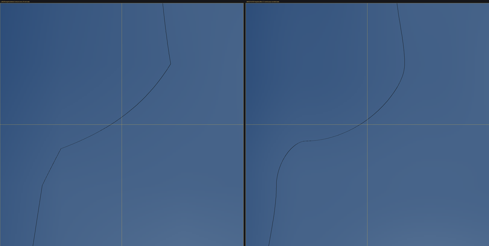

# 02. Сглаживание береговой линии: smoothstep вместо линейной интерполяции климата

**Статус:** реализовано, `dotnet build Game.sln -v q --nologo` → **Ошибок: 0** (6 предупреждений — предсуществующие, `tests/TestJobRaceStress.cs`, не мои).
**Игра не запускалась** (порт 9090 держит Lead), ничего вне согласованного скоупа не изменено.

---

## 1. Корень проблемы (подтверждён по коду)

Климат клетки берётся не из `SampleBlendedCell` на каждую клетку, а из **опорной сетки с шагом 16 клеток**
(`SubSize = 16`: `GenerateChunk` — 5×5 узлов на чанк, `GenerateColonyWindow`/`BulkCellSampler`/`WorldGenV2.GenerateArea` —
`(side/16+1)²`), между узлами — билинейная интерполяция 18 полей Q16.

Линейная интерполяция по `t` даёт **кусочно-линейный** интерполянт: внутри блока изолинии — отрезки, а на каждой
границе блока (каждые 16 клеток) нормальная производная поля **скачет**. Берег воды — это изолиния
`ElevationQ16 = WorldClimateGenerator.SeaLevelQ16 (22000)`, поэтому каждый узел сетки 16×16 — это излом/угол/ступенька
береговой линии. Отсюда и «угловатый берег каждые ~16 тайлов».

Прямое доказательство (независимый численный эксперимент, см. §4): разрыв производной на границах 16-клеточных
блоков **181.7 Q16/клетку в среднем (max 550)** при линейном весе и **0.000** при smoothstep-весе.

---

## 2. Что именно изменено

### 2.1 `src/core/world/generation/UnifiedWorldGenerator.cs` — единственная точка правки климата

Добавлен общий сглаживающий вес (**новый метод**, строки `219-255`):

```csharp
// БЫЛО: такого метода не было
// СТАЛО (фрагмент; в файле метод помечен [MethodImpl(AggressiveInlining)]):
internal static uint SmoothStepQ16(uint t)
{
    const ulong One = 65535ul;
    const ulong OneSq = One * One;          // 4 294 836 225
    ulong x = Math.Min(t, (uint)One);
    ulong shaped = (x * x) * (3ul * One - 2ul * x) + OneSq / 2;
    return (uint)Math.Min(One, shaped / OneSq);
}
```

`LerpClimate1D` (строки `257-287`) — **одна строка изменена**, сам Lerp остался прежним:

```csharp
// БЫЛО (стр. 216-236 до правки): вес t как есть
//   ElevationQ16: LerpQ16(a.ElevationQ16, b.ElevationQ16, t),  ... (18 полей, t)
// СТАЛО:
uint ts = SmoothStepQ16(t);                                    // стр. 267
   ElevationQ16: LerpQ16(a.ElevationQ16, b.ElevationQ16, ts),  // стр. 269 ... 286 (все 18 полей на ts)
```

* `LerpQ16` **не тронут** (строки `209-217`, только уточнён XML-комментарий): он остаётся чистым линейным Lerp,
  сглаживание делает только вызывающий `LerpClimate1D`. Все остальные его вызовы в файле отсутствуют
  (`grep` по `LerpQ16` в файле: определение + 18 строк внутри `LerpClimate1D`), т.е. в не-климатические нужды он не уходит.
* Комментарий в `GenerateChunk` (стр. `156-159`) дополнен пояснением про C¹-непрерывность весов.
* Потребители внутри файла не менялись и получают новый вес автоматически:
  `GenerateChunk` (`195-197`) и `GenerateColonyWindow` (`581-583`).

### 2.2 `src/core/world/generation/WorldGenV2.cs` — удалена вторая копия интерполятора

```csharp
// БЫЛО (стр. 572-602): своя копия LerpQ16 (30 строк) + своя LerpClimate1D с линейным весом
// СТАЛО (стр. 573-585):
private static WorldClimateParams LerpClimate1D(in WorldClimateParams a, in WorldClimateParams b, uint t)
    => UnifiedWorldGenerator.LerpClimate1D(in a, in b, t);
```

Причина: требование «все пути — ОДНА реализация». Теперь `GenerateChunk`, `GenerateColonyWindow`,
`WorldCellQuery.BulkCellSampler` и `WorldGenV2.GenerateArea` (идущий через `ActiveArea` в `Main`) физически не могут
разойтись. Комментарий в шапке файла (`32-35`) описывает это вместо «дословной копии».

### 2.3 `src/core/world/streaming/integration/WorldCellQuery.cs` — только документация

Код **не менялся**: `BulkCellSampler.CellAtLocal` уже вызывает `UnifiedWorldGenerator.LerpClimate1D` (стр. `211-213`),
т.е. получает сглаженный вес автоматически. Обновлён XML-инвариант `BeginBulkSample` (стр. `52-78`): теперь там
явно записано, что вес `t` сглажен smoothstep и что значения в узлах сетки не меняются (шов-инвариант сохранён).

### 2.4 `src/core/world/streaming/generation/WorldClimateGenerator.cs` — только обоснование, код не менялся

`LerpQ16`/`Lerp2D`/`BlendBilinear` (стр. `367-379`) **намеренно оставлены линейными** (подробно в §6.1).
Добавлен комментарий `353-366` с обоснованием и готовой строкой-патчем, если понадобится сгладить и 512-масштаб.

**Итого код изменён в 2 файлах** (`UnifiedWorldGenerator.cs`, `WorldGenV2.cs`), в 2 файлах — только комментарии.

---

## 3. Почему smoothstep

`S(t) = t²(3·65535 − 2t)/65535²`, целочисленно, `t ∈ [0..65535]`:

| свойство | следствие для мира |
|---|---|
| `S(0)=0`, `S(65535)=65535` | **значения в узлах сетки не меняются вообще** → край чанка/окна (кратен 16) — узел, швов нет; выровненные окна побитово совпадают с чанком (инвариант `WorldCellQuery` сохранён) |
| `S'(0)=S'(1)=0` | интерполянт **C¹-непрерывен** на границах блоков: изолинии (берег!) без изломов, углы скругляются дугами |
| `S` строго возрастает | `Lerp` остаётся **выпуклой комбинацией** `a..b`: нет выбросов за диапазон (в отличие от Catmull-Rom), **между узлами не появляется новых экстремумов** → топология берега (острова, заливы, озёра) сохраняется, меняется только форма |
| только `ulong`-арифметика, 0 аллокаций, 0 float | детерминизм байт-в-байт, ноль GC-давления |

Переполнение: `x² ≤ 4.29e9` (влезло бы в `uint`), но `x²·(3·65535−2x) ≤ 2.8e14` — считается в `ulong`, округление одно
(`+OneSq/2` перед делением). Проверено: `S(0)=0`, `S(32768)=32768`, `S(65535)=65535`, монотонность на всём диапазоне —
`True`, максимальное отклонение от точной вещественной формулы — **0.5 Q16** (только округление).

Веса, которые фактически попадают в расчёт (`t = (k%16)·65535/16`):

```
k/16      : 0    1/16  2/16  3/16  4/16  5/16  6/16  7/16   8/16   9/16  10/16 11/16 12/16 13/16 14/16 15/16   16/16
linear    : 0   4095  8191 12287 16383 20479 24575 28671  32767  36863 40959 45055 49151 53247 57343 61439  65535
smoothstep: 0    736  2815  6047 10239 15199 20735 26655  32767  38879 44799 50335 55295 59487 62719 64799  65535
```

---

## 4. Численная проверка эффекта (вне проекта, синтетическое поле)

Скрипт-проверка повторяет **те же целочисленные формулы** (не проектный код), поле — 128×128 клеток, узлы через 16,
порог `SeaLevelQ16 = 22000`.

* разрыв производной на границах 16-клеточных блоков:
  **linear: mean 181.70 / max 550.00 → smoothstep: mean 0.000 / max 0.000** (Q16/клетку);
* вода: 7751 → 7650 клеток (−1.3%, берег локально смещается на ~1 клетку — следствие «выпуклости к ближнему узлу»);
* связных компонент воды: **1 → 1** (новых островков/озёр сглаживание не создаёт — как и обещает монотонность);
* изолинии (marching squares, реальная геометрия уровня моря): в узлах сетки линейный вариант даёт **острый угол**,
  smoothstep — **плавную C¹-кривую** (см. картинку).



Жёлтые линии — опорная сетка климата (16 клеток). Это синтетическая иллюстрация математики, не скриншот игры;
визуальная проверка в игре — §7.

---

## 5. Влияние на скорость генерации

Микробенчмарк (standalone, тот же код `SmoothStepQ16` + `LerpQ16`, Release, .NET 8, 4096 клеток × 3 × 18 Lerp):

* линейная интерполяция: **0.6238 мс/чанк**;
* со smoothstep: **0.6557 мс/чанк**;
* **+0.032 мс на чанк**, т.е. **+5.1% от стоимости самой интерполяции** (= +0.008 мс на 1000 клеток, ~8 нс/клетку).

В реальном коде `LerpClimate1D` вызывается 3 раза на клетку (2× по `u`, 1× по `v`) — итоговая наценка
**≈ 0.05 мс на чанк 64×64 (≈12 нс на клетку)**. Тяжёлая часть генерации чанка — 25 полных `SampleBlendedCell`
(тектоника/Voronoi ×4 региона) + несколько `ValueNoiseQ16` на клетку + сборка биома; на их фоне это **доли процента**
(оценка <0.5% бюджета чанка). Аллокаций нет, дерево вызовов не изменилось, инлайнинг сохранён
(`[MethodImpl(AggressiveInlining)]`), деления — на константы (JIT сворачивает в умножение/сдвиги).

Если когда-нибудь понадобится убрать и эту наценку — `u`/`v` можно сглаживать один раз на строку/столбец в цикле
и передавать уже сглаженный вес, но тогда сглаживание утечёт из `LerpClimate1D` в каждый путь (ровно тот риск
расхождения, который мы устраняем). Сознательно не делал.

---

## 6. Что НЕ изменено и почему

### 6.1 `WorldClimateGenerator.BlendBilinear` (регионный шаг 512) — оставлен линейным

Это интерполяция **центров регионов** (`CenteredBlendNodes`, шаг `WorldRegions.RegionSize = 512`), а не клетки.
Она задаёт **макро-географию планеты** (где континенты/океаны). Сглаживание здесь:
* не имеет отношения к артефакту с периодом 16 (масштаб в 32 раза крупнее, изломы там на порядок слабее);
* сдвинуло бы береговые линии планетарного масштаба для всех сидов и потребовало бы перепроверки региональных
  инвариантов (например, `tests/TestWorldGen`: клетки океанического региона обязаны быть `< SeaLevelQ16`).

Если Lead решит, что нужна C¹-гладкость и на 512-масштабе, — это одна строка в `Lerp2D` (патч записан в комментарии
`WorldClimateGenerator.cs:353-366`); значения в центрах регионов (`u=v=0`) при этом сохраняются точно, а выпуклость
весов сохраняет региональные инварианты. **Решение за Lead'ом — я не расширял скоуп.**

### 6.2 Копии интерполятора вне моего скоупа (⚠ требует правки другим агентом)

Три места содержат **побитовые копии** старого линейного интерполятора и участвуют в видимых/проверяемых путях:

| файл:строка | что делает | последствие, если не поправить |
|---|---|---|
| `src/ui/renderers/MapRenderer.cs:890-892` (копии `:903-935`) | заполнение terrain-окна карты вне `mapData` (вода/песок/трава) | **карта** (мировой обзор) останется с углами каждые 16 клеток и разойдётся со стриминговыми чанками — вероятно, именно там Lead видит баг |
| `src/ui/streaming/StreamingWorldView.cs:1632`, `:1646-1649` (копия `:1671-1677`) | сетка `SoilFertilityQ16` для декора (порог рощ/камней) | деревья/камни у порога разойдутся «окно острова ↔ стриминг» |
| `tests/TestWorldGenV2.cs:587`, `tests/test_streamingview_decor_seam.cs:243` (`LerpQ16Copy`) | независимая копия для parity-проверок | parity-тест начнёт падать (сам тест не запускается через `dotnet build`) |

Минимальный патч для каждого (1 строка в начале их `LerpQ16`/`LerpClimate`; `SmoothStepQ16` — `internal`, доступен в сборке):

```csharp
t = UnifiedWorldGenerator.SmoothStepQ16(t);
```

Я эти файлы не трогал (не мой скоуп) — Lead'у нужно решить, кто их правит.

---

## 7. Риски

1. **Кэш чанков на диске.** `GeneratorVersion` остался `3` (`Main.WorldGeneratorVersion`, `StreamingWorldView.GeneratorVersion`
   — экспорт сцены), поэтому уже сохранённые чанки (`user://infinite_world_lab_cache/world_<seed16>/`) грузятся со старым
   (линейным) климатом → на границе «старый/новый чанк» будет видимый шов берега. Для проверки: новый сид или удалить
   каталог кэша этого сида. Если мир должен остаться тем же — нужен bump `generatorVersion` (3→4) в `Main.cs`/сцене
   `StreamingWorldView` (вне моего скоупа) — тогда старые чанки инвалидируются штатно.
2. **География меняется по форме, не по логике.** Порог воды (`SeaLevelQ16`), биомы, горы, реки, инварианты
   «деревья только на траве» и т.п. не тронуты, но берег локально сдвигается на ~1–2 клетки (узел «притягивает»
   изолинию). Для сида изменится рисунок берега — это ожидаемо и является целью.
3. **«Полка» у узлов.** Из-за `S'(0)=S'(1)=0` градиент поля в самом узле нулевой: изолиния в узле становится
   горизонтальной/вертикальной на 3–6 клеток (видно на картинке §4 как плавный «шельф»). Это гораздо мягче исходных
   углов и дополнительно размывается доменным варпом и шумом холмов (`SampleCell`), но если на скриншотах это прочтётся
   как терраса — альтернатива: монотонный кубический Hermite (Catmull-Rom с клампом) по соседним узлам: тоже C¹, но без
   нулевой производной в узлах; цена — нужны узлы `bx-1..bx+2` (сетка 7×7 вместо 5×5 на чанк, +~2× вызовов
   `SampleBlendedCell`). Не делал: дороже по перфу и это уже не «smoothstep» из задания.
4. **Согласованность путей сохранена по построению** (все зовут одну функцию, `u`/`v` считаются одинаково).
   Но именно поэтому п. 6.2 обязателен к закрытию: копии вне скоупа теперь неверны.
5. **Поведение на границах диапазона**: `t` клампится к `65535` и в `SmoothStepQ16`, и в `LerpQ16` — отрицательных/`>65535`
   весов нет; для `u=v=0` возвращается ровно `a`, для `u=v=65535` ровно `b` (проверено численно).

---

## 8. Как проверить визуально

1. `cd "D:\bebebe-main (1)\bebebe-main"; dotnet build Game.sln -v q --nologo` → `Ошибок: 0`.
2. **Обязательно без старого кэша чанков**: либо новый сид, либо удалить `user://infinite_world_lab_cache/world_<seed16>/`
   (`%APPDATA%\Godot\app_userdata\<project>\infinite_world_lab_cache\...`).
3. Запустить игру, открыть карту (она рисуется `MapRenderer` — **после патча п. 6.2**, иначе карта останется старой),
   затем войти в мир и посмотреть берег острова и внешние берега в стриминге.
4. Критерий «до/после»: было — берег меняет направление **только** на линиях, кратных 16 мировым клеткам (углы/ступеньки
   каждые 16 тайлов, прямые отрезки); стало — линия изгибается плавно, без углов в этих точках.
   Полезно наложить в голове сетку 16 (или сделать скриншот и отмерить): изломов на ней быть не должно.
5. Швы: пройти камерой через границу чанка (кратна 64 = 4×16) — не должно быть ни ступеньки берега, ни полосы другого
   биома; проверить угловую точку на стыке 4 чанков.
6. Декор: деревья/камни не должны «включаться/выключаться» полосой на границе окна острова и стриминга (это проверка п. 6.2).
7. Производительность: оверлей профилирования — ms генерации чанка до/после; ожидаемо в пределах шума (наценка ~0.05 мс/чанк).

**Откат** (если Lead решит не менять мир): в `UnifiedWorldGenerator.cs:267` заменить `uint ts = SmoothStepQ16(t);`
на `uint ts = t;` — остальное (делегирование `WorldGenV2`) откатывать не требуется, поведение станет прежним.

---

## 9. Файлы, которых касался

| файл | характер |
|---|---|
| `src/core/world/generation/UnifiedWorldGenerator.cs` | код: `SmoothStepQ16` (219-255), вес в `LerpClimate1D` (267/269-286), комментарии (156-159, 209-217) |
| `src/core/world/generation/WorldGenV2.cs` | код: удалена копия (`LerpQ16`+`LerpClimate1D`), делегирование (573-585), комментарий шапки (32-35) |
| `src/core/world/streaming/integration/WorldCellQuery.cs` | только XML-комментарий инварианта (52-78) |
| `src/core/world/streaming/generation/WorldClimateGenerator.cs` | только комментарий-обоснование (353-366) |
| `_reports/02_coastline_isolines.png` | иллюстрация §4 (синтетика, не игра) |
